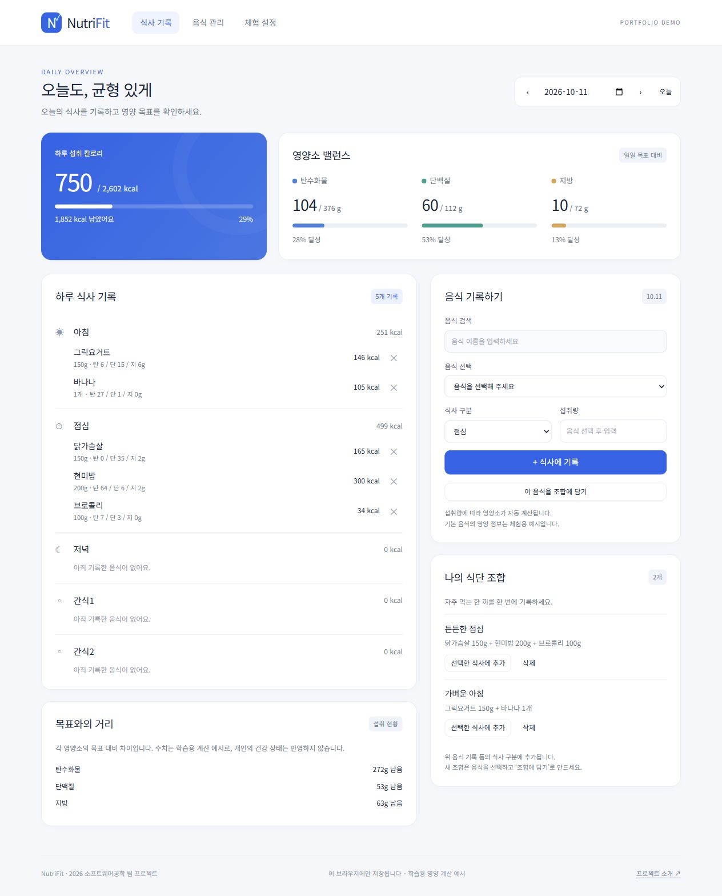

# NutriFit · 맞춤형 식단 매니저

신체 정보와 식단 목표를 바탕으로 하루 목표 칼로리와 탄수화물·단백질·지방 섭취량을 계산하고, 식사 기록과 목표 달성도를 한 화면에서 확인하는 웹 앱입니다.

중앙대학교 **2026년 1학기 소프트웨어공학 6조 팀 프로젝트**를 바탕으로, GitHub Pages에서 체험할 수 있는 브라우저 데모로 정리했습니다. 원본 최종 제출 보고서에 기재된 참여 팀원은 **김보연 · 이주호 · 한재혁**입니다. 이 저장소는 팀 프로젝트의 결과물을 소개하며, 확인되지 않은 개인별 구현 기여를 주장하지 않습니다.

**배포 예정 주소:** [NutriFit 데모](https://hansol000808.github.io/nutrifit/)



[모바일 화면 보기](docs/mobile.jpg)

## 주요 기능

- 성별·나이·키·체중·활동량과 다이어트·유지·벌크업 목표에 따른 일일 목표 계산
- 날짜별 식사 기록과 칼로리·탄수화물·단백질·지방 합계 확인
- 목표 대비 섭취량과 달성도 시각화
- 기본 음식 검색, 사용자 음식 등록·수정, 즐겨찾기
- 자주 먹는 음식들을 식단 조합으로 저장하고 한 번에 기록
- 지난 날짜의 기록 조회와 수정·삭제 제한

## 원본과 공개 데모

| 구분 | 2026년 1학기 원본 | 이 저장소의 브라우저 데모 |
| --- | --- | --- |
| 실행 방식 | Node.js 서버와 브라우저 | 정적 HTML·CSS·JavaScript |
| 데이터 저장 | 서버의 로컬 JSON 파일 | 현재 브라우저의 `localStorage` |
| 사용자 계정 | 회원가입·로그인·세션 | 계정과 로그인 없이 체험 |
| 데이터 공유 | 서버에 저장된 사용자별 데이터 | 브라우저·기기 간 동기화 없음 |
| 배포 | Node.js 실행 환경 필요 | 공개 저장소의 GitHub Pages 무료 정적 호스팅 |

공개 데모에는 원본 사용자 계정, 비밀번호 해시, 세션, 실제 식사 기록을 포함하지 않습니다. 체험용 데이터와 직접 입력한 내용은 현재 브라우저에 저장됩니다. 브라우저 저장소를 지우거나 다른 브라우저·기기로 접속하면 기존 내용을 이어서 사용할 수 없습니다.

여러 탭에서 동시에 내용을 변경하면 마지막에 저장한 내용이 앞선 변경을 덮어쓸 수 있습니다. 브라우저 저장소에는 동시 변경을 합치는 기능이 없습니다.

## 로컬 실행과 테스트

Node.js 20 이상이 설치된 환경에서 실행합니다. 외부 패키지 설치와 별도 빌드 과정은 필요하지 않습니다.

```sh
npm start
```

기본 주소인 `http://127.0.0.1:4173/nutrifit/`를 브라우저에서 엽니다. 실행용 서버는 로컬 미리보기 도구이며 GitHub Pages에서는 사용하지 않습니다.

```sh
npm test
```

테스트는 Node.js 기본 테스트 러너로 실행합니다. 테스트 범위와 실제 구현은 [`tests/core.test.cjs`](tests/core.test.cjs)를 확인할 수 있습니다.

**로컬 검증 기록 — 2026-10-11:** 핵심 로직 테스트 14개가 통과했습니다. 브라우저에서도 새로고침 후 기록 유지, 목표 변경 전 과거 목표 보존, 식단 조합 적용, HTML 형태의 입력을 문자로 표시하는 처리, 지난 날짜의 기록 잠금을 확인했습니다. 이 기록은 로컬 실행 결과이며 공개 주소의 배포 완료를 뜻하지 않습니다.

## 구성

```text
index.html            화면 진입점
style.css             화면 스타일과 반응형 배치
app.js                화면 렌더링, 사용자 입력, 브라우저 저장
lib/core.js           목표 계산과 식사 기록 등 핵심 로직
tests/core.test.cjs   핵심 로직 테스트
scripts/serve.cjs     GitHub Pages 하위 경로를 재현하는 로컬 미리보기
assets/icon.svg       앱 아이콘
docs/PROJECT.md      프로젝트 배경, 구조, 구현 범위
docs/desktop.jpg     데스크톱 데모 화면
docs/mobile.jpg      모바일 데모 화면
```

HTML에서 참조하는 스크립트와 스타일은 저장소 기준 상대 경로를 사용하므로 GitHub Pages의 `/nutrifit/` 경로에서 실행할 수 있습니다. 서버 API나 데이터베이스 연결은 필요하지 않습니다.

## 구현 범위와 한계

이 데모는 하루 단위의 목표 계산과 식사 기록 흐름을 보여주는 포트폴리오용 앱입니다. 음식 영양 정보는 제한된 기본 목록과 사용자 입력을 사용하며, 외부 식품 데이터 API, 자동 식단 추천, 사진 인식, 주간·월간 분석은 구현 범위에 포함하지 않습니다. 목표 수치는 입력값과 계산식에 따른 추정치입니다.

원본의 설계 문서와 실제 구현을 구분한 설명은 [프로젝트 문서](docs/PROJECT.md)에 정리했습니다. 학번, 평가표, 팀 매칭 자료, 수업자료와 원본 사용자 데이터는 공개 대상에서 제외했습니다.
