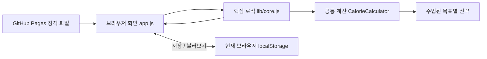

# NutriFit 프로젝트 문서

## 배경과 출처

NutriFit은 중앙대학교 2026년 1학기 소프트웨어공학 6조의 맞춤형 식단 매니저 개발 프로젝트입니다. 사용자의 신체 조건과 다이어트·유지·벌크업 목표에 따라 섭취 목표를 계산하고, 매일의 식사 기록을 목표와 비교하는 흐름을 구현했습니다.

원본 최종 제출 보고서에 기재된 참여 팀원은 김보연, 이주호, 한재혁입니다. 이 공개 저장소는 원본의 기능과 화면 흐름을 바탕으로 브라우저에서 실행할 수 있도록 정리한 데모입니다. 원본 자료만으로 확인할 수 없는 개인별 업무 분담이나 기여 비율은 기재하지 않았습니다.

배포 기준으로 검토한 원본은 최종 제출물의 `src` 폴더입니다. 해당 소스는 제출된 `src.zip`과 일치했으며, 초기 JSON에는 사용자와 세션이 없는 상태였습니다. 작업 중 사용한 별도 JSON과 이전 SQLite 파일에 들어 있던 계정·신체정보·식사 기록은 공개 데모로 가져오지 않았습니다.

## 사용 흐름

1. 샘플로 체험하거나 빈 기록으로 시작합니다.
2. 신체 정보와 활동량, 식단 목표를 설정하고 계산된 하루 목표를 확인합니다.
3. 음식과 섭취량을 선택하여 식사 기록을 추가합니다.
4. 하루 합계와 목표 달성도를 확인합니다.
5. 자주 먹는 음식은 즐겨찾기나 식단 조합으로 관리합니다.
6. 날짜를 이동하여 이전 기록을 조회합니다. 지난 날짜의 기록은 읽기 전용입니다.

## 원본 구조

원본은 외부 패키지 없이 Node.js 내장 `http`, `fs`, `path`, `crypto` 모듈을 사용하는 앱입니다. `public/app.js`가 화면을 렌더링하고 같은 서버의 `/api/` 경로에 요청을 보냅니다. `server.js`는 회원가입·로그인·세션, 목표 계산, 음식·식사·조합 관리를 처리하고 `diet_app_v5_data.json`을 읽고 씁니다.

이 구조에는 실행 중인 Node.js 서버와 쓰기 가능한 파일 저장소가 필요합니다. 정적 파일을 제공하는 GitHub Pages에 원본 파일만 올리는 방식으로는 계정과 기록 API를 실행할 수 없습니다.

## 공개 데모 구조

공개 데모는 서버 API를 브라우저 내부 로직으로 바꾸어 정적 호스팅에서 실행합니다. 계정 인증과 여러 사용자의 공유 저장소는 제공하지 않습니다.

| 파일 | 역할 |
| --- | --- |
| `index.html` | 페이지 진입점과 상대 경로의 자산 연결 |
| `style.css` | 화면 스타일과 반응형 배치 |
| `app.js` | 화면 렌더링, 입력 처리, 브라우저 저장소 연동 |
| `lib/core.js` | 입력 검증, 목표 계산 위임, 음식·식사 기록 관리 |
| `lib/target-strategies.js` | 목표별 전략과 `CalorieCalculator` 공통 계산 컨텍스트 |
| `tests/core.test.cjs` | Node.js 기본 테스트 러너로 실행하는 핵심 로직 검증 |
| `scripts/serve.cjs` | `/nutrifit/` 하위 경로에서 동작을 확인하는 로컬 정적 서버 |
| `assets/icon.svg` | 앱 아이콘 |
| `docs/desktop.jpg`, `docs/mobile.jpg` | 로컬 데모 화면 |

외부 라이브러리 설치와 빌드 과정 없이 HTML·CSS·JavaScript를 그대로 제공합니다. 자산 경로는 저장소 기준 상대 경로를 사용하여 GitHub Pages의 프로젝트 하위 경로에서도 동작하도록 구성합니다.

## 목표 계산 분리 — 2026-10-14

공개 데모의 목표 계산을 독립적인 전략과 공통 계산 컨텍스트로 분리했습니다. 이 변경은 학기 종료 후의 리팩토링이며, 원본 학기 프로젝트의 구현 이력을 바꾸지 않습니다.

[`lib/target-strategies.js`](../lib/target-strategies.js)는 브라우저와 CommonJS 환경에서 사용할 수 있으며 다음 책임을 갖습니다.

| 구성 요소 | 책임 |
| --- | --- |
| `MaintainStrategy`, `DietStrategy`, `BulkUpStrategy` | 각각 `calculate({ weight, tdee })`를 구현하여 목표별 `calories`, `protein`, `fatRatio` 정책값 반환 |
| `CalorieCalculator` | 교체 가능한 전략을 받아 공통 BMR·활동대사량 계산, 전략 호출, 칼로리 한도 보정과 최종 영양소 계산 수행 |
| 목표별 전략 레지스트리 | 목표 식별자와 전략을 연결하여 사용할 전략 선택 |
| `core.calcTargets` | 기존 프로필 검증 후 선택된 전략을 사용하는 계산기로 위임 |

계산 컨텍스트는 다이어트·유지·벌크업을 구분하는 조건 분기 없이 주입된 전략의 공통 메서드를 호출합니다. 같은 계약을 구현하는 다른 전략을 넣어 계산 정책을 교체할 수 있습니다. 확장성 테스트는 별도 전략을 주입해도 기존 컨텍스트와 기본 전략을 수정할 필요가 없는지를 확인하는 범위입니다. 새로운 목표를 실제 서비스 선택지에 추가하려면 UI와 허용 입력값도 함께 연결해야 합니다.

리팩토링은 기존 계산 결과와 화면 동작, `localStorage` 저장 형식을 유지하면서 목표별 정책과 공통 계산을 분리합니다. 관련 테스트는 [`tests/core.test.cjs`](../tests/core.test.cjs)에서 확인할 수 있습니다. 로컬 회귀 검증 결과와 초기 공개 배포 검증 결과는 아래에 날짜별로 기록했습니다.

## 원본 설계 문서와 구현의 구분

원본 보고서와 발표 자료에는 설계 의도, 실제 구현, 향후 계획이 함께 기록되어 있습니다. 포트폴리오에서는 다음과 같이 구분합니다.

| 문서의 설명 | 확인된 구현 또는 상태 |
| --- | --- |
| `CalorieStrategy`, `DietStrategy`, `MaintainStrategy`, `BulkUpStrategy` 클래스 설계 | 원본 구현 결과 장은 전략 패턴의 개념을 함수형으로 적용했다고 설명하며, 원본 `calcTargets`는 목표별 조건 분기를 사용합니다. 교체 가능한 독립 전략 구조는 2026-10-14 공개 데모 리팩토링에서 분리했습니다. |
| 사용자·음식·기록·조합·목표 이력의 관계형 ERD | 데이터 관계를 설명하는 설계 모델입니다. 최종 구현은 사용자 객체 안에 배열과 이력을 저장하는 JSON 구조입니다. |
| 데이터 접근을 담당하는 Repository | 원본 `server.js`의 `load`와 `save` 함수가 파일 입출력을 담당합니다. 별도 Repository 모듈이나 클래스로 분리된 구조는 아닙니다. |
| 마지막 배포 계획의 SQLite 언급 | 이전 버전에 SQLite 사용 흔적이 있으나, 최종 제출본의 저장소는 JSON입니다. |
| 단위·사용성·부하 테스트와 클라우드 이전 | 원본 보고서에서는 향후 계획으로 적혀 있습니다. 해당 문장만으로 원본의 자동 테스트나 운영 배포가 완료됐다고 볼 수 없습니다. |

원본 보고서의 설계 의도와 함수 단위로 단순화한 구현을 구분합니다. 현재 데모의 독립 전략 구조를 원본 학기 프로젝트에서 이미 구현한 것으로 소급해 설명하지 않습니다. 현재 동작 범위와 검증 범위는 공개된 코드와 각 날짜의 테스트 기록을 기준으로 합니다.

## 데이터와 공개 범위

- 데모에는 체험용 데이터만 포함하며 원본 계정, 비밀번호 해시, 세션, 실제 사용자 기록을 포함하지 않습니다.
- 입력 내용은 현재 브라우저의 `localStorage`에 저장됩니다. 서버 백업, 계정 복구, 여러 기기 간 동기화는 없습니다.
- 여러 탭에서 동시에 저장하는 경우에는 마지막 저장이 앞선 변경을 덮어쓸 수 있습니다. `localStorage`에 기록을 쓰기 전에 최신 상태를 읽지만, 여러 탭의 읽기·수정·저장 전체를 하나의 트랜잭션으로 묶거나 충돌을 병합하지는 않습니다.
- 브라우저 데이터 삭제, 비공개 브라우징 종료, 기기 변경 등에 따라 기록을 사용할 수 없게 될 수 있습니다.
- 학번과 평가표, 팀 매칭 자료, 수업자료는 저장소에 포함하지 않습니다. 원본 보고서·발표 전체도 공개 데모의 실행 파일에 포함하지 않습니다.
- 팀 프로젝트의 출처와 확인된 참여 팀원 표기는 유지하며, 개인별 기여 내역은 추가로 추정하지 않습니다.

## 실행 및 배포 검증 기록

**2026-10-14 — 목표 계산 리팩토링의 로컬 검증**

`node --test tests/core.test.cjs`로 실행한 **테스트 19개가 모두 통과**했습니다. 기존 데이터·날짜·입력 검증에 더해 기본 전략과 사용자 정의 전략의 교체, 잘못된 전략과 정책값 거부, 공통 한도 보정 적용, HTML의 실제 스크립트 순서에 따른 브라우저 방식 로딩과 CommonJS 결과 일치를 검사했습니다.

별도의 회귀 검증에서는 변경 전 공개 데모 커밋 `c6a2922`의 `core.calcTargets`와 현재 코드를 메모리에서 실행해 비교했습니다. 성별 2종 × 나이 3종 × 키 3종 × 체중 4종 × 활동량 5종 × 목표 3종으로 구성한 **1,080개 프로필 조합에서 칼로리·탄수화물·단백질·지방의 네 계산값이 모두 동일**했습니다. 이 비교는 위 19개 테스트와 별도로 수행했으며, 두 결과 모두 로컬 코드 기준입니다.

**2026-10-11 — 초기 공개 데모의 로컬·배포 검증**

Node.js 기본 테스트 러너로 실행한 **핵심 로직 테스트 14개가 통과**했습니다. 검사 범위는 지역 날짜와 윤일, 목표 계산과 잘못된 입력, 명시적인 초기화, 가상 샘플 데이터, 손상된 저장 상태, 저장소 읽기·쓰기 실패, 음식 변경 후 과거 기록 보존, 조합의 음식 참조, 조합 적용 중 실패 시 저장 방지, 과거 기록 잠금, 날짜별 목표 보존, 데이터 사본과 상태 스키마 검사입니다. 구체적인 조건과 예상값은 [`tests/core.test.cjs`](../tests/core.test.cjs)에 있습니다.

로컬 브라우저에서는 다음 흐름을 확인했습니다.

- 새로고침한 뒤에도 저장한 내용 유지
- 목표를 변경해도 이전 날짜의 목표 유지
- 식단 조합의 식사 기록 일괄 추가
- HTML 태그 형태의 입력을 실행하지 않고 문자로 표시
- 지난 날짜의 기록 추가·삭제 제한

[공개 데모](https://hansol000808.github.io/nutrifit/)는 [공개 GitHub 저장소](https://github.com/hansol000808/nutrifit)의 `main` 브랜치 루트를 GitHub Pages 소스로 사용합니다. 공개 주소에서도 빈 기록으로 시작했을 때 기록이 0개인 상태, 계란 1개 추가 시 70kcal 반영, 새로고침 후 기록 유지, 샘플 데이터 초기화를 확인했습니다. 이 검증 중 브라우저 콘솔 오류는 발생하지 않았습니다.

Node.js 20 이상에서 `npm start`로 미리보기를 실행하고, `npm test`로 핵심 로직 테스트를 재실행할 수 있습니다. 별도 부하 시험이나 모든 브라우저·기기에 대한 호환성 검증을 완료한 것으로 해석하지 않습니다.

## 범위와 확장 방향

현재 데모는 하루 단위의 식사 기록과 달성도 확인에 집중합니다. 음식 영양 정보는 기본 목록과 사용자 입력에 기반하며, 칼로리·영양소 목표는 입력값과 계산식을 바탕으로 한 추정치입니다.

다음 항목은 현재 제공 기능이 아닌 확장 방향입니다.

- 계정 인증과 사용자별 서버 저장소
- 여러 기기 간 동기화와 백업
- 공공 식품 영양 데이터 API 연동
- 주간·월간 섭취 추이 분석
- 사진 인식이나 자동 식단 추천

실행은 `npm start`, 핵심 로직 테스트는 `npm test`로 수행합니다. 원본 검토 당시의 문제와 현재 데모의 개선 여부는 코드와 실제 테스트 결과를 기준으로 구분해야 하며, 정적 데모 공개를 다중 사용자 서비스의 운영 준비 완료로 해석하지 않습니다.
