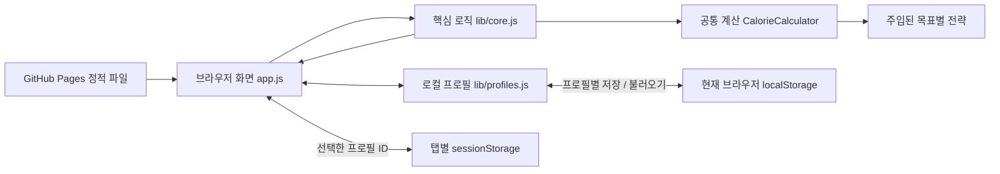

# NutriFit 프로젝트 문서

## 프로그램 소개

NutriFit은 신체 정보와 다이어트, 유지, 벌크업 목표에 따라 하루 섭취 목표를 계산하고, 식사 기록과 목표 달성도를 확인하는 웹 앱입니다. 같은 브라우저에서 여러 로컬 프로필의 신체 정보, 음식과 식사 기록을 구분해 관리합니다.

[NutriFit 실행하기](https://hansol000808.github.io/nutrifit/)

## 사용 흐름

1. 로컬 프로필을 만들고 샘플로 체험하거나 빈 기록으로 시작합니다. 기존 프로필을 선택해 이어서 사용할 수도 있습니다.
2. 신체 정보와 활동량, 식단 목표를 설정하고 계산된 하루 목표를 확인합니다.
3. 음식과 섭취량을 선택하여 식사 기록을 추가합니다.
4. 하루 합계와 목표 달성도를 확인합니다.
5. 자주 먹는 음식은 즐겨찾기나 식단 조합으로 관리합니다.
6. 날짜를 이동하여 이전 기록을 조회합니다. 지난 날짜의 기록은 읽기 전용입니다.

## 프로그램 구조

HTML, CSS와 JavaScript로 구성된 정적 웹 앱이며 계산과 데이터 저장을 브라우저에서 처리합니다. 여러 로컬 프로필의 기록을 구분하며, 데이터는 현재 브라우저의 저장소에 보관합니다.

| 파일 | 역할 |
| --- | --- |
| `index.html` | 페이지 진입점과 상대 경로의 자산 연결 |
| `style.css` | 화면 스타일과 반응형 배치 |
| `app.js` | 화면 렌더링, 입력 처리, 브라우저 저장소 연동 |
| `lib/core.js` | 입력 검증, 목표 계산 위임, 음식·식사 기록 관리 |
| `lib/target-strategies.js` | 목표별 전략과 `CalorieCalculator` 공통 계산 컨텍스트 |
| `lib/profiles.js` | 프로필 목록·생성·삭제, 프로필별 저장 어댑터와 단일 저장 데이터 이관 |
| `tests/core.test.cjs` | Node.js 기본 테스트 러너로 실행하는 핵심 로직 검증 |
| `tests/profiles.test.cjs` | 프로필 격리, 이관, 삭제와 저장 실패 검증 |
| `scripts/serve.cjs` | `/nutrifit/` 하위 경로에서 동작을 확인하는 로컬 정적 서버 |
| `assets/icon.svg` | 앱 아이콘 |
| `docs/desktop.jpg`, `docs/mobile.jpg` | 화면 예시 |



외부 라이브러리 설치와 빌드 과정 없이 HTML·CSS·JavaScript를 그대로 제공합니다. 자산 경로는 저장소 기준 상대 경로를 사용하여 GitHub Pages의 프로젝트 하위 경로에서도 동작하도록 구성합니다.

## 목표 계산

목표별 계산 정책을 독립적인 전략으로 구성하고, 공통 계산기가 선택한 전략에 계산을 위임합니다.

[`lib/target-strategies.js`](../lib/target-strategies.js)는 브라우저와 CommonJS 환경에서 사용할 수 있으며 다음 책임을 갖습니다.

| 구성 요소 | 책임 |
| --- | --- |
| `MaintainStrategy`, `DietStrategy`, `BulkUpStrategy` | 각각 `calculate({ weight, tdee })`를 구현하여 목표별 `calories`, `protein`, `fatRatio` 정책값 반환 |
| `CalorieCalculator` | 교체 가능한 전략을 받아 공통 BMR·활동대사량 계산, 전략 호출, 칼로리 한도 보정과 최종 영양소 계산 수행 |
| 목표별 전략 레지스트리 | 목표 식별자와 전략을 연결하여 사용할 전략 선택 |
| `core.calcTargets` | 기존 프로필 검증 후 선택된 전략을 사용하는 계산기로 위임 |

계산 컨텍스트는 다이어트·유지·벌크업을 구분하는 조건 분기 없이 주입된 전략의 공통 메서드를 호출합니다. 같은 계약을 구현하는 다른 전략을 넣어 계산 정책을 교체할 수 있습니다. 확장성 테스트는 별도 전략을 주입해도 기존 컨텍스트와 기본 전략을 수정할 필요가 없는지를 확인하는 범위입니다. 새로운 목표를 실제 서비스 선택지에 추가하려면 UI와 허용 입력값도 함께 연결해야 합니다.

목표 계산과 전략 교체의 검증 조건은 [`tests/core.test.cjs`](../tests/core.test.cjs)에서 확인할 수 있습니다.

## 로컬 프로필과 목표 검증

### 프로필별 저장

로컬 프로필은 이름과 고유 ID를 가지며, 각 프로필의 신체 정보, 음식, 즐겨찾기, 식단 조합, 식사 기록과 목표 이력을 별도의 `localStorage` 항목에 저장합니다. 이름은 1~40자이며 프로필은 최대 20개까지 만들 수 있습니다. 하나의 전체 목록을 매번 덮어쓰는 대신 각 프로필의 데이터를 따로 읽고 씁니다. 따라서 다른 프로필의 기록을 수정하거나 샘플·빈 기록으로 초기화해도 선택하지 않은 프로필의 저장 항목을 변경하지 않습니다. 프로필 삭제도 선택한 프로필을 대상으로 합니다.

현재 선택한 프로필 ID는 `sessionStorage`에 저장하여 탭마다 선택을 유지합니다. 여러 탭에서 서로 다른 프로필을 사용할 수 있지만, 같은 프로필을 동시에 편집하는 경우에는 마지막 저장이 앞선 변경을 덮어쓸 수 있습니다. 충돌 병합이나 여러 탭에 걸친 트랜잭션을 제공하는 구조는 아닙니다.

단일 저장 항목 `nutrifit.demo.v1`에 데이터가 있으면 고정 ID `legacy`, 이름 `기존 기록`인 프로필로 복사합니다. 복사한 원본 항목을 보관하고 프로필별 저장 항목에서 기록을 관리합니다. 이미 복사한 프로필을 원본으로 다시 덮어쓰지 않으며, 삭제한 기존 프로필을 자동으로 다시 가져오지 않습니다. 이관 대상은 같은 브라우저에 저장된 데이터입니다.

[`lib/profiles.js`](../lib/profiles.js)의 `createManager`는 `list`, `create`, `remove`, `getStore`, `migrateLegacy`를 제공합니다. `getStore`는 해당 프로필의 저장 항목만 사용하는 어댑터를 통해 기존 핵심 로직을 호출합니다.

| 저장 항목 | 용도 |
| --- | --- |
| `nutrifit.profile.v1.<프로필 ID>` | 버전, ID, 이름, 생성 시각과 해당 프로필의 데이터 |
| `nutrifit.profile.deleted.v1.<프로필 ID>` | 삭제한 ID의 표식. 다른 탭의 오래된 저장이나 기존 데이터 재이관으로 프로필이 복구되는 것을 방지 |
| `nutrifit.demo.v1` | 프로필로 가져올 단일 저장 데이터. 복사 후에도 자동 삭제하지 않음 |
| `nutrifit.activeProfile.v1` (`sessionStorage`) | 해당 탭에서 선택한 프로필 ID |

손상된 데이터나 저장소 접근·쓰기 실패가 발생하면 오류를 표시하고 자동 초기화를 하지 않습니다. 이관 과정은 원본 저장 항목을 수정하지 않습니다. 삭제된 프로필은 이름과 기록 대신 ID와 삭제 여부만 남기지만, 복사에 사용한 단일 저장 항목은 별도로 보관됩니다.

프로필 분리는 기록의 저장 범위를 구분하는 기능입니다. 같은 브라우저의 프로필 목록에는 로그인 없이 접근할 수 있으며, 다른 사람의 접근을 막는 인증이나 권한 제어를 제공하지 않습니다.

### 목표의 열량 일관성 검증

하루 목표 칼로리의 한도를 보정한 뒤, 반올림하기 전 단백질과 지방의 열량 합계가 목표를 초과하는지 검사합니다. `단백질(g) × 4 + 지방(g) × 9 > 목표 칼로리(kcal)`이면 해당 조건의 새 목표 저장을 거부합니다. 탄수화물을 0으로 보정하는 것만으로 단백질과 지방의 초과분을 해결한 것으로 처리하지 않습니다.

이전에 저장된 목표와 식사 기록은 자동으로 다시 계산하거나 삭제하지 않습니다. 저장된 목표는 이미 정수로 반올림된 값이므로 별도 기준으로 확인합니다. `탄수화물(g) × 4 + 단백질(g) × 4 + 지방(g) × 9`와 저장된 칼로리의 차이가 9kcal를 초과하면 안내를 표시합니다. 작은 반올림 오차는 허용하며, 새 설정은 반올림 전 검증을 통과해야 저장할 수 있도록 합니다. 이는 계산값 사이의 일관성을 검사하는 규칙이며 개인에게 적합한 영양 섭취량을 보장하는 기준은 아닙니다.

## 데이터와 공개 범위

- 샘플 데이터는 기본 음식 목록을 사용한 가상의 식사 기록입니다.
- 입력 내용은 현재 브라우저의 `localStorage`에 저장됩니다. 서버 백업, 계정 복구, 여러 기기 간 동기화는 없습니다.
- 프로필별 데이터는 별도 저장 항목을 사용하고, 선택한 프로필 ID는 탭의 `sessionStorage`에 저장합니다. 로컬 프로필은 회원 계정이나 접근 권한 경계가 아닙니다.
- 같은 프로필을 여러 탭에서 동시에 저장하는 경우에는 마지막 저장이 앞선 변경을 덮어쓸 수 있습니다. 기록을 쓰기 전에 최신 상태를 읽지만, 여러 탭의 읽기·수정·저장 전체를 하나의 트랜잭션으로 묶거나 충돌을 병합하지는 않습니다.
- 브라우저 데이터 삭제, 비공개 브라우징 종료, 기기 변경 등에 따라 기록을 사용할 수 없게 될 수 있습니다.

## 실행 및 테스트

Node.js 20 이상에서 실행합니다. 외부 패키지 설치나 별도 빌드는 필요하지 않습니다.

```sh
npm start
```

[http://127.0.0.1:4173/nutrifit/](http://127.0.0.1:4173/nutrifit/)에서 미리보기를 엽니다. 로컬 서버는 정적 파일을 제공하며 앱의 데이터는 브라우저에 저장됩니다.

```sh
npm test
```

Node.js 기본 테스트 러너로 `tests/*.test.cjs`를 실행합니다.

| 테스트 파일 | 검사 범위 |
| --- | --- |
| [핵심 로직 테스트](../tests/core.test.cjs) | 입력과 날짜 검증, 목표 계산과 전략 교체, 열량 불일치 거부, 저장된 목표의 안내, 음식과 식사 기록, 과거 기록 및 목표 보존, 저장 실패 시 상태 유지 |
| [프로필 테스트](../tests/profiles.test.cjs) | 프로필별 저장과 초기화, 프로필 선택과 삭제, 단일 저장 데이터 이관, 삭제된 프로필의 재생성 방지, 손상된 데이터와 저장 실패 처리 |

[공개 웹 앱](https://hansol000808.github.io/nutrifit/)은 저장소의 `main` 브랜치 루트를 GitHub Pages에서 제공합니다.

## 범위와 확장 방향

NutriFit은 하루 단위의 식사 기록과 달성도 확인에 집중합니다. 음식 영양 정보는 기본 목록과 사용자 입력에 기반하며, 칼로리·영양소 목표는 입력값과 계산식을 바탕으로 한 추정치입니다.

다음 항목은 현재 제공 기능이 아닌 확장 방향입니다.

- 계정 인증과 사용자별 서버 저장소
- 여러 기기 간 동기화와 백업
- 공공 식품 영양 데이터 API 연동
- 주간·월간 섭취 추이 분석
- 사진 인식이나 자동 식단 추천

